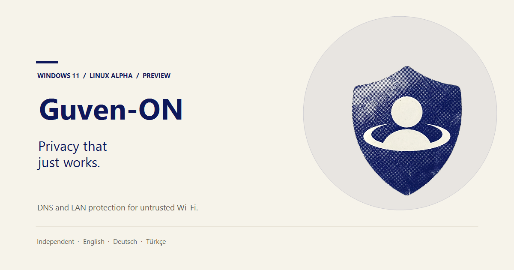

<p align="center">
  <a href="https://github.com/tutualican/guvenon/releases/latest">
    
  </a>
</p>

<p align="center">
  <a href="https://github.com/tutualican/guvenon/releases/latest"></a>
  <a href="https://github.com/tutualican/guvenon/releases/latest"></a>
  <a href="https://github.com/tutualican/guvenon/releases"></a>
</p>

<p align="center">
  
  
  
  
</p>

## Protection without the babysitting.

Guven-ON is a small security tool for the networks you do not control. It blocks
DNS leaks and local-network exposure on public Wi-Fi, then gets out of the way.
No account. No tunnel. No per-query logs.

- **DNS leaks, closed.** Trusted resolvers only; plain DNS and DNS-over-TLS to
  everything else are blocked.
- **Local exposure, contained.** Private IPv4 and IPv6 ranges, multicast and
  legacy discovery are isolated. Printers, NAS devices and consoles can be
  allowlisted by exact IP.
- **Quiet by design.** Enforcement lives in the platform filter engine. There is
  no tunnel crypto, no keepalive and no packet capture.

## At a glance

| | |
|:--|:--|
| **Release** | `0.2.2` preview · unsigned |
| **Platforms** | Windows 11 22H2+ x64 · Linux alpha `.deb` x64 |
| **Windows engine** | Persistent WFP filters + adapter DNS |
| **Linux engine** | nftables + systemd-resolved |
| **Languages** | English · German · Turkish |
| **License** | Apache-2.0 |

## Install

### Windows 11

1. Download the [latest installer](https://github.com/tutualican/guvenon/releases/latest).
2. Run it once and accept the single UAC prompt.
3. Open Guven-ON from the notification area and turn on protection.

The tray app runs as `asInvoker`; only installation, updates and service
maintenance need elevation.

### Linux alpha

```bash
sudo apt install ./guvenon_0.2.2_amd64.deb
sudo guvenonctl enable
sudo guvenonctl status
```

Pause for a captive portal with `sudo guvenonctl pause 10`. Restore everything
immediately with `sudo guvenonctl panic`.

> [!IMPORTANT]
> Preview builds are unsigned. Verify the SHA-256 published with each release,
> or build from source. Protection is **off until you enable it**.

## Privacy

Guven-ON is a local security tool, not a data business.

- Per-query DNS logging is off by design.
- Settings and protection state stay on your device.
- Every release publishes an open update manifest and SHA-256 hash.
- The UI is driven by aggregate counters and state changes, never the sites you
  visit.

## What the guard actually does

- **Trusted DNS.** Active adapters are pointed at Cloudflare and Quad9 while
  protection is enabled.
- **DNS guard.** UDP/TCP 53 and DNS-over-TLS 853 are permitted only to those
  resolvers. Local resolvers stay blocked even if their device is allowlisted.
- **LAN isolation.** Private IPv4 ranges, IPv6 ULA and multicast are blocked,
  along with legacy discovery protocols.
- **Crash-safe filters.** On Windows the filters are persistent WFP objects. A
  service crash leaves them installed; the next start re-applies the policy or
  removes stale objects.
- **Local-device allowlist.** Exact IPv4 and IPv6 addresses stay reachable above
  the LAN and discovery blocks.
- **Pause and panic.** A ten-minute pause handles captive portals, then resumes
  automatically. Panic disables protection and restores DNS immediately.
- **Self-test.** The Windows service re-opens the WFP store and verifies every
  expected filter instead of trusting its in-memory state.

## Preview status

Windows enforcement is real and covered by an elevated integration workflow:
enable, self-test, allowlist persistence, pause cleanup, forced service crash,
restart recovery, disable and uninstall cleanup.

The Linux package has CI builds, packaging and nftables syntax validation, but it
has not yet been exercised on a physical Linux host.

Known gaps:

- Windows 11 sleep/wake and captive-portal leak matrix still needs a physical
  test host.
- DNS-over-HTTPS on port 443 is not intercepted.
- Full IPv6 isolation, VPN/split-DNS modelling and automatic trust profiles are
  not implemented.
- The allowlist accepts exact addresses only, not CIDR ranges.
- The Windows control pipe accepts any authenticated local user; interactive-user
  restriction is future hardening.
- Code signing, SmartScreen reputation and WinGet community submission are still
  open.

## Under the hood

<details>
<summary><strong>Windows enforcement</strong></summary>

The LocalSystem service owns a persistent WFP provider, sublayer and filter set.
Replacement and removal run in a transaction. Intent is written to
`%ProgramData%\GuvenOn\service-state.json` before policy changes, so a restart can
restore an enabled guard without leaving a fail-open window.

Filter weights keep the policy ordered: trusted DNS permits, DNS blocks, local
device permits, LAN/discovery blocks and baseline permits. Clean uninstall and
`--wfp-cleanup` remove leftover objects.

```powershell
guvenonsvc.exe --status
guvenonsvc.exe --selftest
guvenonsvc.exe --enable
guvenonsvc.exe --pause 10
guvenonsvc.exe --disable
guvenonsvc.exe --wfp-cleanup
guvenonsvc.exe --restore-network
```

</details>

<details>
<summary><strong>Linux alpha</strong></summary>

The root daemon listens on `/run/guvenon/control.sock` and builds an isolated
`inet guvenon` nftables table. DNS integration prefers a systemd-resolved
drop-in; the fallback writes `/etc/resolv.conf`.

```bash
sudo systemctl status guvenon
sudo guvenonctl status
sudo guvenonctl enable
sudo guvenonctl pause 10
sudo guvenonctl allowlist 192.168.1.50
sudo guvenonctl panic
```

A PolicyKit/D-Bus frontend, NetworkManager integration and arm64 packages remain
on the roadmap.

</details>

<details>
<summary><strong>Updates without the GitHub API</strong></summary>

The app requests:

```text
https://github.com/tutualican/guvenon/releases/latest/download/latest.json
```

That is a release-asset redirect, not the REST API. It needs no token and does
not consume the unauthenticated API budget. A CDN mirror at
`https://dl.guvenon.app/win/latest.json` is tried only if GitHub is unreachable.

Each release uploads `latest.json` next to the installer. Generate it with:

```powershell
powershell.exe -NoProfile -ExecutionPolicy Bypass -File .\scripts\make-manifest.ps1 `
  -InstallerPath .\artifacts\installer\GuvenOnSetup-0.2.2.exe -Version 0.2.2
```

The app verifies the version and offers a download link from the manifest.
Manifest signing (ECDSA P-256) and silent install/rollback are wired in only
after signing keys exist.

</details>

<details>
<summary><strong>Build from source</strong></summary>

Requirements:

- Windows 11 22H2 or newer, x64
- .NET 10 SDK
- Inno Setup 6 for the installer step

The SDK can be installed without administrator rights:

```powershell
$installer = "$env:TEMP\dotnet-install.ps1"
Invoke-WebRequest https://dot.net/v1/dotnet-install.ps1 -OutFile $installer
powershell.exe -NoProfile -ExecutionPolicy Bypass -File $installer -Channel 10.0
```

Build a self-contained release:

```powershell
powershell.exe -NoProfile -ExecutionPolicy Bypass `
  -File .\build.ps1 -Configuration Release -Runtime win-x64 -SelfContained -Installer
```

Outputs are written to `artifacts/publish/`, `artifacts/installer/` and
`artifacts/latest.json`.

Run the tests:

```powershell
$env:PATH = "$env:LOCALAPPDATA\Microsoft\dotnet;$env:PATH"
dotnet test GuvenOn.slnx -c Release -warnaserror
```

For local development with a user-local SDK, set `DOTNET_ROOT` before starting
the app or service:

```powershell
$env:DOTNET_ROOT = "$env:LOCALAPPDATA\Microsoft\dotnet"
.\src\GuvenOn.App\bin\Debug\net10.0-windows\guvenon.exe
```

The Windows service can be installed and controlled explicitly:

```powershell
.\artifacts\publish\svc\guvenonsvc.exe --install
.\artifacts\publish\svc\guvenonsvc.exe --uninstall
```

Linux packaging:

```bash
bash linux/build-deb.sh
```

That produces `artifacts/linux/guvenon_<version>_amd64.deb` and installs the
daemon, `guvenonctl` and the systemd unit.

</details>

<details>
<summary><strong>Installer, WinGet and repository layout</strong></summary>

The Inno Setup installer in `installer/GuvenOn.iss` installs the tray app under
`{autopf}\Guven-ON`, the service under `{app}\service`, optional per-user
autostart and a clean uninstaller. It requests administrator rights once.

WinGet manifests for `Tutualican.GuvenOn` live in
`winget/manifests/t/Tutualican/GuvenOn/0.2.2/`. Validate the current version:

```powershell
winget validate --manifest .\winget\manifests\t\Tutualican\GuvenOn\0.2.2
```

Repository layout:

```text
src/GuvenOn.App      WPF tray app and localized UI
src/GuvenOn.Core     shared policy, settings, autostart, SemVer, update manifest
src/GuvenOn.Service  Windows service, WFP engine, DNS configurator
src/GuvenOn.Linux    Linux daemon and guvenonctl CLI
tests/GuvenOn.Tests  policy, WFP-facing rules, update, state and control tests
installer/           Inno Setup script
linux/               systemd unit, Debian control scripts and .deb builder
winget/              WinGet manifests
assets/              shield icon and repository social card
scripts/             icon and update-manifest helpers
.github/workflows/   release and elevated WFP integration pipelines
```

</details>

<details>
<summary><strong>Brand assets</strong></summary>

The supplied shield artwork is cleaned by `scripts/make-icon.ps1`. It produces
the application icon, the tray icon and the two images used by this page:

- `src/GuvenOn.App/Assets/Guven-ON.png` (cleaned, transparent)
- `src/GuvenOn.App/Assets/guvenon.ico` (16-256 px)
- `assets/guvenon.png` (256 px repository icon)
- `assets/og.png` (1200x630 social card)

Regenerate them after changing the artwork:

```powershell
powershell.exe -NoProfile -ExecutionPolicy Bypass -File .\scripts\make-icon.ps1
```

The script removes black or near-white corners with a flood fill and preserves
the light details inside the shield.

</details>

<details>
<summary><strong>Security model and known limits</strong></summary>

- The tray app runs with the user's normal token. It cannot change firewall or
  DNS policy by itself.
- The service runs as `LocalSystem` and is the only component that owns WFP
  filters and DNS policy. IPC commands are enumerated, never free-form.
- The Windows control pipe currently accepts any authenticated local user, so
  another signed-in user on a shared machine could toggle protection.
- A clean service stop removes WFP filters and restores DNS. The next service
  start re-applies an enabled policy, leaving a short boot-time gap.
- VPN and virtual adapters are not modelled. VPN-internal DNS or LAN access can
  be blocked while protection is on.
- On Linux without systemd-resolved, the `/etc/resolv.conf` fallback can be
  overwritten by NetworkManager or another resolver manager.
- The local-device allowlist does not accept CIDR ranges and cannot turn an
  allowed device into a DNS resolver.
- Preview installers are unsigned until the code-signing account is active.

</details>

## Roadmap

The detailed, research-backed backlog lives in [ROADMAP.md](ROADMAP.md).

1. Trust-aware profiles and automatic captive-portal detection.
2. DNS-over-HTTPS coverage and full IPv6 isolation.
3. A physical Windows/Linux leak matrix for sleep, wake and portal recovery.
4. PolicyKit/D-Bus and NetworkManager integration on Linux.
5. VPN/split-tunnel awareness, signed update manifests and rollback.
6. Code signing, SmartScreen reputation and WinGet community submission.

## License

Apache License 2.0. See [LICENSE](LICENSE).

---

<div align="center">
  <sub>Independent project. Not affiliated with Microsoft.<br>
  Built for Windows 11 and Linux · English · Deutsch · Türkçe</sub>
</div>
